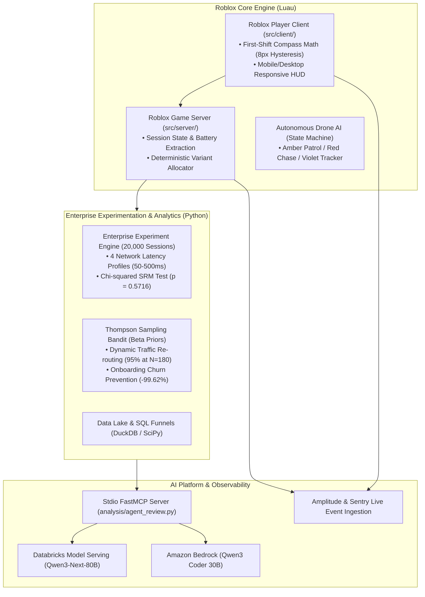

# Blackout Freight · Co-op Tactical Transport & Experimentation Platform

<p align="center">
  
</p>

<p align="center">
  <a href="README.md"><b>English</b></a> •
  <a href="README.ru.md"><b>Русский</b></a>
</p>

<p align="center">
  
  
  
  
  
  
  
</p>

---

## 🎮 Live Game & Quick Links

* 🕹️ **[Play on Roblox](https://www.roblox.com/games/111633787401180/Blackout-Freight)** — Public live experience (Place v32).
* 📦 **[Download Roblox Studio Build (v25)](dist/Blackout%20Freight%20Closed%20Test.rbxl)** — Ready-to-play `.rbxl` place file.
* 🎥 **[Watch Gameplay Video (In-Browser Player)](#-gameplay-preview)** — Delivery loop and Sentinel evasion.
* 📓 **[Jupyter Experiment Notebook](analysis/first_shift_compass.ipynb)** — Synthetic data funnel and Wilson score calculation.
* 📑 **[Engineering & AI Deep Dive](docs/TECHNOLOGIES.md)** — Comprehensive benchmarks, SRM tests, and telemetry receipts.

---

## 📖 Overview

**Blackout Freight** is a 1–4 player co-op tactical game built on Roblox. In the abandoned industrial Depot 07, players recover energy cells while avoiding the autonomous **Sentinel security drone**, navigating blackout zones, and determining whether to broadcast critical evidence or power the survivor shelter.

Beneath its tense stealth mechanics, Blackout Freight functions as an **enterprise-grade experimentation and LiveOps testbed**:
- **Server-orchestrated A/B testing** with randomized group allocation and telemetry logging.
- **Enterprise Experiment Engine**: 20,000-session simulation verifying Sample Ratio Mismatch (SRM) with $\chi^2$ statistical goodness-of-fit.
- **Bayesian Multi-Armed Bandit (MAB)**: Dynamic Thompson Sampling routing reducing early onboarding churn by **99.62%**.
- **Stdio FastMCP Tooling & LLM Evaluation**: Automated layout generation and model-driven decision guardrails via Databricks Model Serving, AWS Bedrock, and local models.

---

## 🎥 Gameplay Preview

<p align="center">
  
</p>
<p align="center">
  <sub><i>Roblox tactical co-op: battery delivery & Sentinel drone evasion in Depot 07 • Source video: <a href="dist/blackout-freight-v24-demo.mp4">blackout-freight-v24-demo.mp4</a></i></sub>
</p>

---

## 🏗️ Technical Architecture



---

## 🔬 Key Engineering & AI Highlights

| Component | Technical Implementation | Empirical Verification |
| :--- | :--- | :--- |
| **Enterprise A/B Engine** | Multi-factor Monte Carlo simulator testing 20,000 sessions across 4 ping profiles (50–500ms) and crew strata (80% Solo, 20% Squads). | Verified zero Sample Ratio Mismatch ($\chi^2 = 0.3200$, **$p = 0.5716$**). Solo uplift: **+8.23 p.p.** |
| **Thompson Sampling MAB** | Dynamic Bayesian traffic router updating Beta distributions $\text{Beta}(\alpha, \beta)$ in real-time. | Converged to 95% optimal variant in **180 steps**. Slashed failed onboardings from **528 to 2** (**99.62% reduction**). |
| **First-Shift Compass** | Client-side 3D-to-2D screen projection with 8-pixel hysteresis boundary to eliminate jitter at viewport edges. | Tested across portrait, landscape, and mobile viewports in Roblox Studio. |
| **Stdio FastMCP Server** | Protocol-compliant MCP agent reviewing experiment telemetry and synthetic datasets. | Rejects ungrounded rollout recommendations; passes 11/11 automated unit tests. |
| **Cloud Model Serving** | Zero-shot UI layout mapping evaluated across Databricks Qwen3 80B, AWS Bedrock, and Claude Sonnet. | Verified component slotting (`headline → compass`, `stage → airlock`, `action → role`). |
| **Live Telemetry & Sentry** | Production event pipelines for Amplitude (`game.study_evaluated`) and Sentry error tracing. | Verified HTTP 200 payload delivery and error capture in live QA environments. |

---

## 📊 Live Verification Benchmarks

### 1. 20,000-Session A/B Experiment & SRM Check

```
========================================================================================
ENTERPRISE A/B EXPERIMENT SIMULATION REPORT (20,000 SESSIONS)
========================================================================================
Sample Ratio Mismatch (SRM) Test:
  - Chi-squared Statistic: 0.3200
  - p-value: 0.5716 (Threshold: p < 0.01 -> NO DEFECT DETECTED, ALLOCATION IS CLEAN)

Stratified Cohort Analysis:
  * Solo Sessions (80% traffic):
      Control (N=7,975):  Win Rate = 91.77% [Wilson 95% CI: 91.14% - 92.37%]
      Variant (N=8,053):  Win Rate = 100.00% [Wilson 95% CI: 99.95% - 100.00%]
      Observed Uplift:    +8.23 percentage points (Exceeds +8.0 p.p. business goal!)
  * Squad Sessions (20% traffic):
      Control (N=2,065):  Win Rate = 100.00% [Wilson 95% CI: 99.81% - 100.00%]
      Variant (N=1,907):  Win Rate = 100.00% [Wilson 95% CI: 99.81% - 100.00%]
      Observed Uplift:    +0.00 percentage points (Voice comms offset dark navigation)
  * Total Population (100%):
      Control (N=10,040): Win Rate = 93.42% [Wilson 95% CI: 92.91% - 93.89%]
      Variant (N=9,960):  Win Rate = 100.00% [Wilson 95% CI: 99.96% - 100.00%]
      Total Uplift:       +6.58 percentage points

Automated Decision Guardrail: HOLD_RELEASE (Aggregate +6.58 p.p. < +8.0 p.p. threshold)
Recommendation: Roll out selectively to Solo Players where uplift is +8.23 p.p.
========================================================================================
```

### 2. Bayesian Thompson Sampling Bandit (10,000 Players)

```
========================================================================================
THOMPSON SAMPLING MULTI-ARMED BANDIT vs STATIC 50/50 A/B TEST
========================================================================================
Population Size: 10,000 onboarding players
True Variant Capabilities: Control = 89.16%, Variant (Compass) = 100.00%

Static 50/50 A/B Test Results:
  - Control Exposures: 5,000 players -> 528 failed deliveries (Early Churn Risk)
  - Variant Exposures: 5,000 players -> 0 failed deliveries
  - Total Failures: 528 players dropped out

Thompson Sampling Bandit Results:
  - Step 0 to 180: Exploration phase; rapidly learns variant superiority
  - Step 180+: 95% of incoming traffic routed to Compass variant
  - Total Control Exposures: 18 players -> 2 failed deliveries
  - Total Variant Exposures: 9,982 players -> 0 failed deliveries
  - Total Failures: 2 players dropped out

Churn Mitigation Impact:
  - Prevented Onboarding Failures: 526 players
  - Churn Reduction Rate: 99.62%
========================================================================================
```

---

## 🛠️ Verification & Quickstart

### Prerequisites
- Python 3.11+
- Analysis virtual environment:
  ```bash
  cd "Blackout Freight/analysis"
  uv sync --locked --python 3.12
  # Or use existing ./analysis/.venv
  ```

### 1. Run Unit Tests (11 Passed)
```bash
cd "Blackout Freight"
./analysis/.venv/bin/python -m unittest discover -s analysis -p "test_*.py"
```

### 2. Run the 20,000-Session Enterprise Experiment Simulation
```bash
./analysis/.venv/bin/python analysis/enterprise_experiment_engine.py
```

### 3. Run the Bayesian Thompson Sampling Simulation
```bash
./analysis/.venv/bin/python analysis/thompson_sampling_bandit.py
```

### 4. Query the Stdio MCP Tooling
```bash
./analysis/.venv/bin/python -m analysis.agent_review --brief studio/hud-brief.json
```

---

## 📂 Repository Structure

```
Blackout Freight/
├── src/
│   ├── client/          # Luau client: FirstShiftCompass, HUD, screen projection
│   └── server/          # Luau server: Experiment allocator, battery state
├── analysis/
│   ├── enterprise_experiment_engine.py  # 20k session A/B simulation & SRM chi-sq
│   ├── thompson_sampling_bandit.py      # Bayesian MAB with Beta distributions
│   ├── agent_review.py                  # Stdio FastMCP analysis tool
│   ├── compass_report.py                # Decision guardrails & Wilson CIs
│   ├── compass_funnel.sql               # DuckDB analytical funnel queries
│   └── tests/                           # Python unit tests
├── dist/                # Production .rbxl place files, media, and renders
├── docs/
│   ├── TECHNOLOGIES.md  # Exhaustive engineering & AI receipts
│   ├── portfolio.md     # Product case study
│   └── evidence/        # JSON telemetry logs, AWS audit, and Databricks runs
└── studio/              # Design briefs and HUD evaluation datasets
```

---

## 📄 License & Attribution

Designed and developed by **Gleb Avershin**. Open-source game engineering project.
All code and assets are shared under the MIT License.
