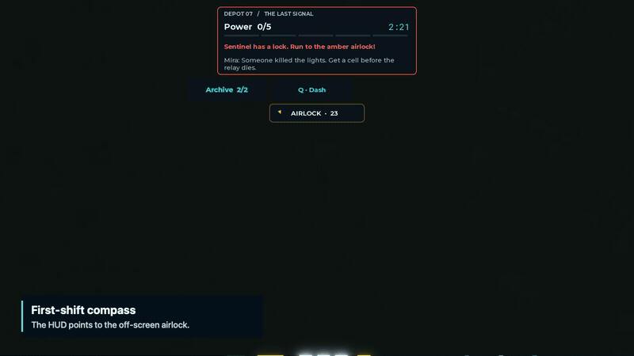
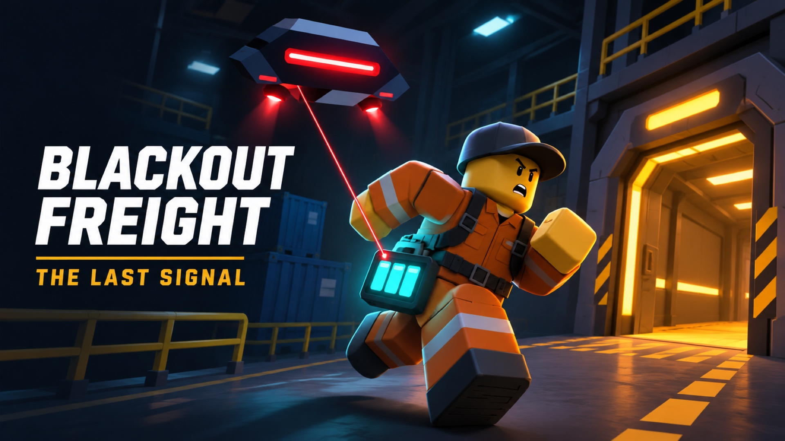

# Blackout Freight

Blackout Freight is a 1–4 player co-op Roblox game. Recover batteries from Depot 07 while evading a security drone, then decide where to send the last of the depot’s power.

**Portfolio case study** · I shipped a first-shift compass to the Roblox closed test and instrumented a randomized experiment around the first delivery. In v24, Roblox Analytics received all four event stages for each variant during internal QA. The public notebook demonstrates the analysis on synthetic data.

[Read the case study](docs/portfolio.md) · [Watch the v24 demo](dist/blackout-freight-v24-demo.mp4) · [Download the Studio build](https://raw.githubusercontent.com/GlebAvershin/blackout-freight/main/dist/Blackout%20Freight%20Portfolio%20Preview.rbxl) · [Open the notebook](analysis/first_shift_compass.ipynb) · [View GitHub Actions](https://github.com/GlebAvershin/blackout-freight/actions/workflows/verify.yml)

## Об игре

Кооперативная игра Roblox для 1–4 игроков. В ночном Депо 07 нужно пронести пять батарей мимо дрона Sentinel и выбрать, куда направить последний резерв энергии: передать доказательства в эфир или запитать укрытие.

[Страница игры в Roblox](https://www.roblox.com/games/111633787401180/Blackout-Freight) · [Сборка для Studio](dist/Blackout%20Freight%20Closed%20Test.rbxl) · [Игровой ролик](dist/blackout-freight-chase-gameplay.mp4)

## Компас первой смены

[Открыть в Roblox Studio](dist/Blackout%20Freight%20Portfolio%20Preview.rbxl) · [Кейс на английском](docs/portfolio.md) · [A/B-тест первой доставки](docs/first-shift-experiment.md)

Компас первой смены подсказывает направление и расстояние до батареи или шлюза, когда метка выходит из кадра. В Studio он доступен в подходящей смене после загрузки персонажа. Поверни камеру в сторону от цели, чтобы увидеть стрелку. Успешная доставка выключает компас. Расчёт воронки и доверительных интервалов можно повторить в [Jupyter](analysis/first_shift_compass.ipynb) на синтетических данных.

## Что есть в игре

- Две концовки и сохраняемый журнал. После обеих концовок открываются особые маршруты и записи диспетчера Миры.
- «Чёрный ящик» на Западном обходе. Один игрок несёт кейс, второй отвлекает Sentinel маяком. При совместном извлечении оба получают время экипажа.
- Личный рекорд смены и еженедельные контракты с наградой за три разные недели.
- Блэкаут сектора с предупреждением и командные метки для батареи, опасности и направления.
- Ежедневная смена на Тревоге 1 с общей раскладкой, личными рекордами по размеру экипажа и недельной Стеной славы. У ролей есть косметические награды за мастерство.
- Мобильный HUD со сворачиваемыми подсказками. В журнале настройки звука и кнопка закрытия закреплены отдельно от прокручиваемых записей.
- Шкафчик с бесплатным оформлением за прохождение и предпросмотром Aurora Lens и «Экипажа Депо 07».

## Как запустить

1. Скачай [сборку](dist/Blackout%20Freight%20Closed%20Test.rbxl) и открой её в Roblox Studio через **File → Open from File**.
2. Нажми **Play**. Депо строится при запуске сервера.
3. Следуй за бирюзовой меткой к батарее. На ПК взаимодействие выполняется клавишей **E**, на телефоне — нажатием игровой подсказки. Сдай батарею в янтарном шлюзе. Журнал открывается экранной кнопкой или клавишей **J**.
4. Для кооператива используй **Server & Clients**. Для телефона включи **Device Simulator** и проверь обе ориентации.

В закрытом тесте Roblox опубликована версия 24 с компасом первой смены. Сборки Closed Test, Progression Preview и Portfolio Preview в `dist/` совпадают с проектом Rojo. В локальном тесте журнал хранится до остановки сервера, а приглашения Roblox доступны в опубликованной игре. [Отчёт по версии 24](docs/portfolio-release-2026-11-16.md) · [Сценарий живой проверки](docs/playtest/live-checklist.md)

## Документация

- [Руководство игрока](docs/game-guide.md) — первая смена, управление, финалы, роли и прогрессия.
- [Руководство разработчика](docs/development.md) — установка на Windows и macOS, сборка из Git, архитектура, тесты и развёртывание в Roblox.
- [Чек-лист закрытого теста](docs/playtest/live-checklist.md) · [Отчёт по версии 24](docs/portfolio-release-2026-11-16.md) · [Дизайн главы](docs/last-signal.md) · [Аудио](docs/audio-design.md) · [Рынок и монетизация](docs/market-and-monetization.md).

## Дальнейшая разработка

[План расширения](docs/expansion-plan-2026-11.md) · [Фактическое состояние этапов](docs/expansion-status.md). В ветке разработки доступны Scrap за доставки, бесплатные позывные и нарукавные знаки за ранг, выбор Тревоги 1–3, Мастерская, четыре роли (Носильщик, Приманка, Разведчик и Техник), а также Грузовой двор с движущимся составом и новой записью Миры. Карта выбирается в журнале после обеих концовок у всего экипажа. На Тревоге 2–3 такой экипаж встречает Следопыта: он видит груз по прямой и ищет последнее замеченное место после потери цели. Эти изменения опубликованы в существующем месте закрытого теста 13 ноября 2026.

[Предварительная сборка прогрессии для Studio](dist/Blackout%20Freight%20Progression%20Preview.rbxl). В Studio прогресс хранится только до завершения тестового сервера.

## Проверенный кандидат расширения

Роль экипажа и настройки музыки/эффектов теперь сохраняются вместе с профилем. Проверки собственных аналитических событий исключают владельца и тестовые аккаунты.

[Отчёт QA от 13 ноября](docs/release-qa-2026-11-13.md) · [Комплект внешнего теста и Share Links](docs/playtest/README.md) · [Проверка DevEx](docs/devex-review-2026-11-13.md).

Полный локальный прогон запускается командой `python3 scripts/run-release-qa.py`. Он последовательно запускает Studio и сохраняет результаты в `.tools/release-qa-*`.

Перед публикацией: `python3 scripts/check-release.py`. Проверка требует точного совпадения файла с текущим production-проектом Rojo и отклоняет QA-копии. [Отчёт публикации](docs/expansion-publication-2026-11-13.md).

[Проверка в Roblox Player](docs/live-player-2026-11-13.md): на двух разных опубликованных серверах восстановлены настройка музыки и прежние концовки/записи Миры для аккаунта владельца. Многопользовательский облачный тест и реальная покупка этим не подтверждаются.

Сквозной тест новой концовки, Scrap и роли: `python3 scripts/run-persistence-studio-qa.py`. [Результаты двух процессов Studio](docs/persistence-qa-2026-11-13.md); облачные сохранения этим сценарием не проверяются.

## Событие «Потерянный сигнал»

В текущей ветке добавлен бесплатный трек на 13 ноября — 24 декабря 2026 UTC: 5 / 15 / 30 личных проверенных доставок, победы «Эфир» и «Укрытие», три новые записи Миры и постоянный знак «Эхо». История находится в прокручиваемом журнале, без дополнительных панелей поверх игры. Полученное сохраняется после события; Robux не нужны. Это бесплатное событие, не платный Shift Pass.

[Состояние проверки и выпуска](docs/lost-signal-qa-2026-11-13.md) · [Полный остаток исходного плана](docs/remaining-plan-2026-11-13.md).

«Потерянный сигнал», Тревога 4–5, Рой и новые улучшения опубликованы в закрытом тесте 13 ноября 2026. [Отчёт публикации](docs/advanced-publication-2026-11-13.md) · [Сценарий живой проверки](docs/playtest/live-checklist.md).

[Игровые правила, проверка и условия включения монетизации](docs/advanced-heat-and-commerce.md).
