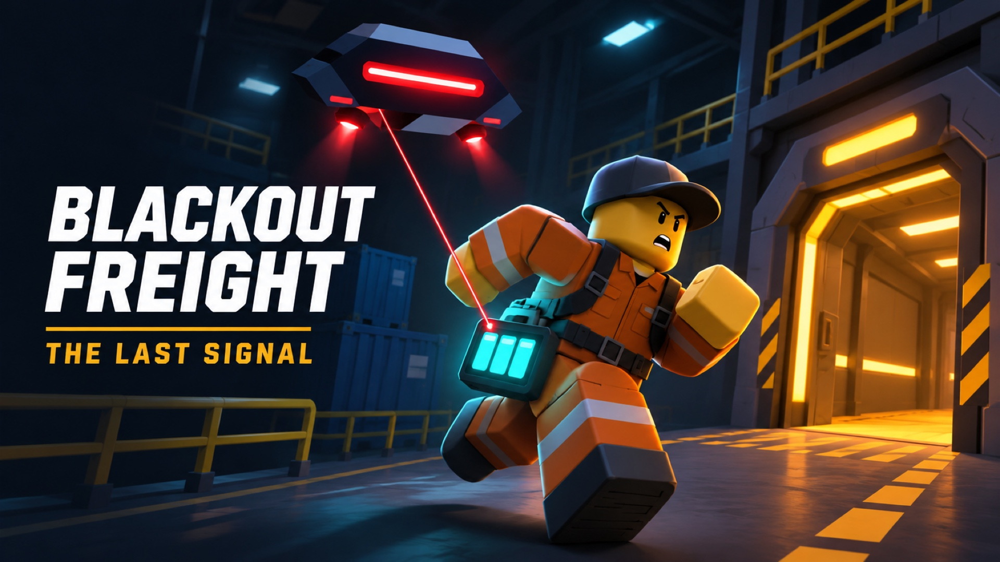

# Blackout Freight

Кооперативная игра Roblox для 1–4 игроков. В ночном Депо 07 нужно пронести пять батарей мимо дрона Sentinel и выбрать, куда направить последний резерв энергии: передать доказательства в эфир или запитать укрытие.



[Страница игры в Roblox](https://www.roblox.com/games/111633787401180/Blackout-Freight) · [Сборка для Studio](dist/Blackout%20Freight%20Closed%20Test.rbxl) · [Игровой ролик](dist/blackout-freight-chase-gameplay.mp4)

## Что есть в игре

- Две концовки и сохраняемый журнал. После обеих концовок открываются особые маршруты и записи диспетчера Миры.
- «Чёрный ящик» на Западном обходе. Один игрок несёт кейс, второй отвлекает Sentinel маяком. При совместном извлечении оба получают время экипажа.
- Личный рекорд смены и еженедельные контракты с наградой за три разные недели.
- Мобильный HUD со сворачиваемыми подсказками. В журнале настройки звука и кнопка закрытия закреплены отдельно от прокручиваемых записей.
- Шкафчик с бесплатным оформлением за прохождение и предпросмотром Aurora Lens и «Экипажа Депо 07».

## Как запустить

1. Скачай [сборку](dist/Blackout%20Freight%20Closed%20Test.rbxl) и открой её в Roblox Studio через **File → Open from File**.
2. Нажми **Play**. Депо строится при запуске сервера.
3. Следуй за бирюзовой меткой к батарее. На ПК взаимодействие выполняется клавишей **E**, на телефоне — нажатием игровой подсказки. Сдай батарею в янтарном шлюзе. Журнал открывается экранной кнопкой или клавишей **J**.
4. Для кооператива используй **Server & Clients**. Для телефона включи **Device Simulator** и проверь обе ориентации.

Опубликованное место работает в режиме закрытого теста. В локальном тесте журнал хранится до остановки сервера, а приглашения Roblox доступны в опубликованной игре. [Сценарии закрытого теста](docs/closed-test.md)

## Сборка и проверки

Понадобятся [Rojo](https://rojo.space/) версии из [rokit.toml](rokit.toml) и [Luau CLI](https://github.com/luau-lang/luau). Для мобильного прогона нужны macOS, Roblox Studio и Python 3.

```sh
rojo build -o 'dist/Blackout Freight Closed Test.rbxl'
luau-compile --null src tests
for test in tests/*.test.luau; do luau "$test" || exit 1; done
python3 scripts/run-mobile-studio-qa.py
```

| Путь | Содержимое |
| --- | --- |
| [src/client](src/client) | HUD, журнал, шкафчик и аудио |
| [src/server](src/server) | Смены, депо, сохранения и проверка владения пропусками |
| [src/shared](src/shared) | Правила игры, маршруты, контракты и конфигурация |
| [tests](tests) | Проверки правил, сохранений и сценарии Studio |
| [dist](dist) | Сборка Roblox Studio и материалы для карточки игры |

## Публикация

Обновляй существующее [стартовое место Blackout Freight](https://create.roblox.com/dashboard/creations/experiences/10775560304/places/111633787401180/configure) через Studio. После публикации проверь историю версий, доступ **Playtesters** и лимит в четыре игрока. Скрипт [publish-closed-test.py](scripts/publish-closed-test.py) без аргументов сверяет локальный файл и показывает его SHA-256. С флагом `--publish` он публикует сборку через Open Cloud после ввода ключа.

[План закрытого теста](docs/closed-test.md) · [Дизайн главы](docs/last-signal.md) · [Аудио](docs/audio-design.md) · [Рынок и монетизация](docs/market-and-monetization.md)
