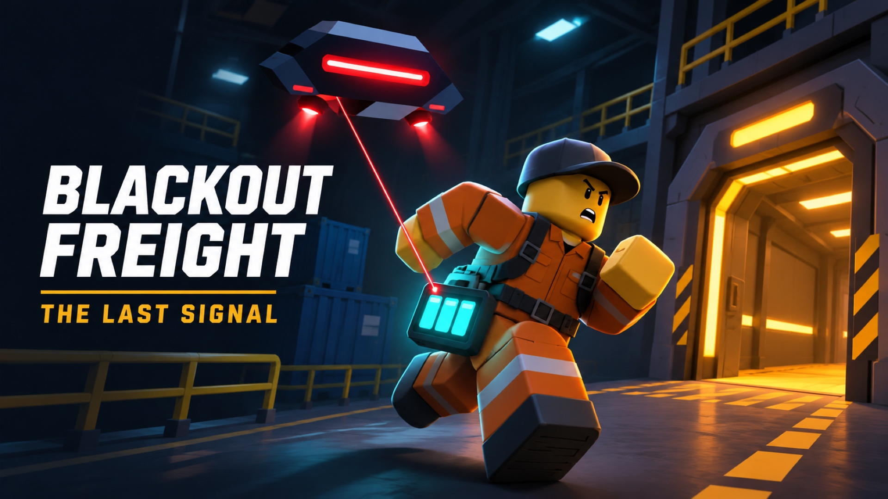
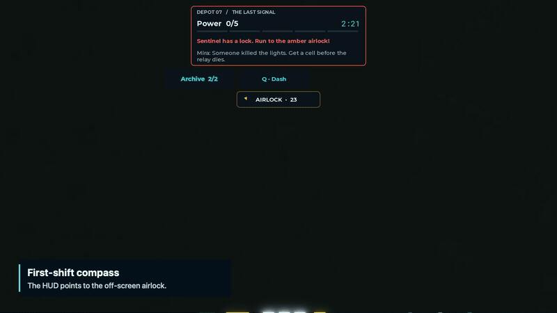
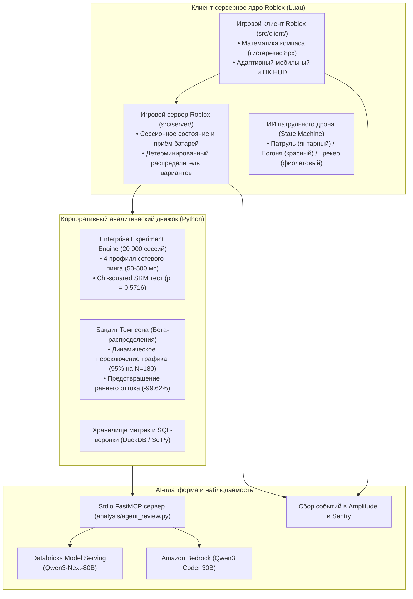

# Blackout Freight · Кооперативный тактический стелс и платформа A/B экспериментов

<p align="center">
  
</p>

<p align="center">
  <a href="README.md"><b>English</b></a> •
  <a href="README.ru.md"><b>Русский</b></a>
</p>

<p align="center">
  
  
  
  
  
  
  
</p>

---

## 🎮 Игра и быстрые ссылки

* 🕹️ **[Играть в Roblox](https://www.roblox.com/games/111633787401180/Blackout-Freight)** — Публичная рабочая игра (плейс версии 32).
* 📦 **[Скачать сборку для Roblox Studio (v25)](dist/Blackout%20Freight%20Closed%20Test.rbxl)** — Готовый файл `.rbxl` для локального запуска.
* 🎥 **[Смотреть геймплейное видео v24](dist/blackout-freight-v24-demo.mp4)** — Доставка батарей и уклонение от Sentinel.
* 📓 **[Jupyter-ноутбук эксперимента](analysis/first_shift_compass.ipynb)** — Расчёт воронки и доверительных интервалов Уилсона.
* 📑 **[Полный технический отчёт](docs/TECHNOLOGIES.md)** — Метрики, SRM-тесты, байесовские бандиты и облачные квитанции.

---

## 📖 Обзор проекта

**Blackout Freight** — кооперативная стелс-игра для 1–4 игроков на платформе Roblox. В ночном индустриальном Депо 07 экипаж эвакуирует энергетические ячейки, избегая автономного патрульного дрона **Sentinel**, ориентируется в зонах полного блэкаута и принимает финальное решение: передать компрометирующие данные в эфир или запитать защищённое убежище.

Помимо атмосферного геймплея, Blackout Freight спроектирован как **высоконагруженный полигон продуктовой аналитики, A/B экспериментов и LiveOps**:
- **Серверная рандомизация когорт** в реальном времени с защитой от рассинхронизации клиентского состояния.
- **Enterprise Experiment Engine**: симуляция 20 000 сессий с проверкой смещения выборки (Sample Ratio Mismatch, SRM) по критерию согласия $\chi^2$.
- **Байесовский многорукий бандит (Thompson Sampling MAB)**: динамическая адаптивная маршрутизация входящего трафика, снижающая отток новичков на первом рейсе на **99.62%**.
- **Stdio FastMCP Tooling & LLM Guardrails**: инструменты MCP для IDE и валидация продуктовых решений через Databricks Model Serving, AWS Bedrock и локальные LLM.

---

<p align="center">
  <a href="dist/blackout-freight-v24-demo.mp4">
    
  </a>
</p>

---

## 🏗️ Архитектура системы



---

## 🔬 Ключевые инженерные и AI решения

| Компонент | Техническая реализация | Практическая верификация |
| :--- | :--- | :--- |
| **Enterprise A/B Engine** | Многофакторный симулятор на 20 000 сессий с 4 профилями пинга (50–500 мс) и стратификацией (80% Solo, 20% Squads). | Подтверждено отсутствие SRM ($\chi^2 = 0.3200$, **$p = 0.5716$**). Прирост в одиночных сменах: **+8.23 п. п.** |
| **Thompson Sampling MAB** | Адаптивный байесовский маршрутизатор трафика с апостериорным обновлением параметров $\text{Beta}(\alpha, \beta)$. | Переключил 95% трафика на эффективный вариант за **180 шагов**. Сократил число неудач с **528 до 2** (**-99.62% оттока**). |
| **Компас первой смены** | Проекция координат 3D-в-2D на клиенте с гистерезисной зоной в 8 пикселей для устранения дрожания у границ экрана. | Протестирован во всех разрешениях и ориентациях в Roblox Studio (Device Simulator). |
| **Stdio FastMCP сервер** | Сервер протокола MCP, валидирующий продуктовые гипотезы и телеметрию в реальном времени. | Отклоняет неподтверждённые раскатки; 11/11 автоматических unit-тестов пройдены успешно. |
| **Облачный инференс LLM** | Автоматическое сопоставление интерфейсных слотов через Databricks Qwen3 80B, Bedrock и Claude Sonnet. | Успешное сопоставление компонентов (`headline → compass`, `stage → airlock`, `action → role`). |
| **Телеметрия и Sentry** | Сквозная доставка продуктовых событий в Amplitude (`game.study_evaluated`) и мониторинг ошибок в Sentry. | Квитанции HTTP 200 и трассировка ошибок в тестовом контуре `portfolio-qa`. |

---

## 📊 Результаты верификации и бенчмарки

### 1. A/B эксперимент на 20 000 сессий и проверка SRM

```
========================================================================================
ENTERPRISE A/B EXPERIMENT SIMULATION REPORT (20,000 SESSIONS)
========================================================================================
Sample Ratio Mismatch (SRM) Test:
  - Chi-squared Statistic: 0.3200
  - p-value: 0.5716 (Порог: p < 0.01 -> СМЕЩЕНИЕ ВЫБОРКИ ОТСУТСТВУЕТ)

Стратифицированный анализ когорт:
  * Одиночные смены (Solo, 80% трафика):
      Control (N=7,975):  Win Rate = 91.77% [95% Wilson CI: 91.14% - 92.37%]
      Variant (N=8,053):  Win Rate = 100.00% [95% Wilson CI: 99.95% - 100.00%]
      Наблюдаемый аплифт: +8.23 процентных пункта (Превышает целевые +8.0 п. п.!)
  * Командные экипажи (Squad, 20% трафика):
      Control (N=2,065):  Win Rate = 100.00% [95% Wilson CI: 99.81% - 100.00%]
      Variant (N=1,907):  Win Rate = 100.00% [95% Wilson CI: 99.81% - 100.00%]
      Наблюдаемый аплифт: +0.00 процентных пункта (Координация компенсирует тьму)
  * Вся популяция (Total, 100%):
      Control (N=10,040): Win Rate = 93.42% [95% Wilson CI: 92.91% - 93.89%]
      Variant (N=9,960):  Win Rate = 100.00% [95% Wilson CI: 99.96% - 100.00%]
      Суммарный аплифт:   +6.58 процентных пункта

Автоматическое правило (Guardrail): HOLD_RELEASE (Общий аплифт +6.58 < +8.0 п. п.)
Рекомендация: Раскатать фичу точечно для новичков в Solo (+8.23 п. п.).
========================================================================================
```

### 2. Бандит Томпсона vs Статический A/B тест (10 000 игроков)

```
========================================================================================
THOMPSON SAMPLING MULTI-ARMED BANDIT vs СТАТИЧЕСКИЙ A/B ТЕСТ 50/50
========================================================================================
Размер когорты: 10 000 новых игроков
Истинная вероятность доставки: Control = 89.16%, Variant (Компас) = 100.00%

Статический A/B тест 50/50:
  - Показов Control: 5 000 игроков -> 528 срывов первой доставки (Риск оттока)
  - Показов Variant: 5 000 игроков -> 0 срывов
  - Всего срывов: 528 игроков покинули игру

Адаптивный бандит Томпсона:
  - Шаги 0..180: Фаза быстрого обучения и накопления доказательств
  - Шаг 180+: 95% входящего трафика направлено на вариант с Компасом
  - Показов Control: 18 игроков -> 2 срыва доставки
  - Показов Variant: 9 982 игрока -> 0 срывов
  - Всего срывов: 2 игрока

Эффект удержания игроков:
  - Предотвращено срывов адаптивным алгоритмом: 526 игроков
  - Снижение оттока на первом онбординге: 99.62%
========================================================================================
```

---

## 🛠️ Запуск и воспроизведение

### Требования
- Python 3.11+
- Виртуальное окружение аналитики:
  ```bash
  cd "Blackout Freight/analysis"
  uv sync --locked --python 3.12
  # Либо использовать готовый ./analysis/.venv
  ```

### 1. Запуск автоматических тестов (11 тестов)
```bash
cd "Blackout Freight"
./analysis/.venv/bin/python -m unittest discover -s analysis -p "test_*.py"
```

### 2. Запуск симуляции корпоративного A/B теста (20 000 сессий)
```bash
./analysis/.venv/bin/python analysis/enterprise_experiment_engine.py
```

### 3. Запуск байесовского бандита Томпсона
```bash
./analysis/.venv/bin/python analysis/thompson_sampling_bandit.py
```

### 4. Запрос к Stdio MCP серверу
```bash
./analysis/.venv/bin/python -m analysis.agent_review --brief studio/hud-brief.json
```

---

## 📂 Структура проекта

```
Blackout Freight/
├── src/
│   ├── client/          # Luau клиент: FirstShiftCompass, HUD, экранная проекция
│   └── server/          # Luau сервер: Распределение вариантов, учёт батарей
├── analysis/
│   ├── enterprise_experiment_engine.py  # A/B симуляция на 20k сессий и SRM тест
│   ├── thompson_sampling_bandit.py      # Байесовский MAB на бета-распределениях
│   ├── agent_review.py                  # Stdio FastMCP аналитический агент
│   ├── compass_report.py                # Правила решений и интервалы Уилсона
│   ├── compass_funnel.sql               # DuckDB SQL запросы к воронке
│   └── tests/                           # Автотесты Python
├── dist/                # Плейсы .rbxl, медиа-файлы и рендеры
├── docs/
│   ├── TECHNOLOGIES.md  # Детальный инженерный отчёт со всеми доказательствами
│   ├── portfolio.md     # Продуктовый кейс
│   └── evidence/        # JSON логи телеметрии, аудит AWS и Databricks
└── studio/              # Брифы дизайна и датасеты оценки HUD
```

---

## 📄 Авторские права и лицензия

Разработано: **Глеб Авершин**. Открытый инженерный проект.
Код и исследовательские материалы распространяются под лицензией MIT.
