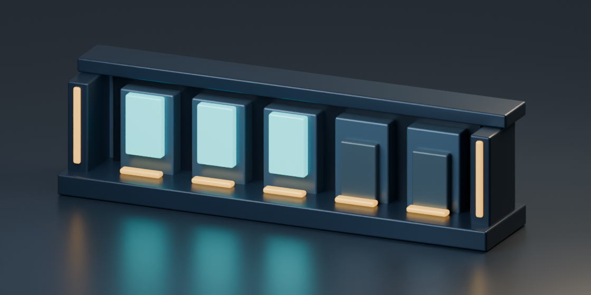

# Blackout Freight · аудит системы

На момент аудита последним подтверждённым релизом закрытого теста был v24. Затем Roblox опубликовал v25. [Результаты публикации и проверок](releases/v25-rc.1.md) Исходная точка аудита — коммит `c1f60dc`. Кандидат v25-rc.1 улучшает обратную связь при сдаче батареи, контроль данных и выпуск сборок. Им можно пользоваться локально в Studio. [Облачная проверка v24](portfolio-release.md) · [Состав кандидата](releases/v25-rc.1.md)

## Игровая смена

| Область | Что показала проверка | Решение |
| --- | --- | --- |
| Ориентация и обратный путь | У входа работает компас первой доставки. Пять старых ламп на консоли лежали горизонтально и были плохо различимы с подхода. | Развернули индикацию к игроку. По высоте и свечению каждой кассеты можно прочитать счёт. Следующий тест на новичках должен показать, замечают ли игроки момент выбора финала. |
| Графика, анимация и доступность | Шлюз служит и маркером маршрута, и местом взаимодействия. Дополнительная панель заняла бы место на мобильном экране. | Стойка размещена в мире. 23 неподвижно закреплённые детали, включая пять кассет. Ход кассеты — 0,31 stud за 0,24 с. При Reduced Motion положение меняется сразу. Новая геометрия исключена из физического взаимодействия и лучевых запросов. |
| Аудио и косметика | Раньше даже со стандартной батареей владелец Aurora слышал тон Aurora. | Тон доставки учитывает выбранную отделку. В Studio проверено переключение Standard → Aurora → Standard при действующем пропуске. |
| Сложность и кооператив | Дрон, приманка, роли, блэкаут и выбор финала уже задают разные задачи экипажу. В тестовом протоколе нет наблюдений внешних новичков. | В выпуске сохранили темп смены и экономику. Для внешних сессий фиксировать самостоятельный подбор за 45 с, сдачу за 90 с и начало следующей смены. [Протокол](playtest/README.md) |
| Производительность | Стойка обновляется по изменению заряда. Анимация выполняется на клиенте без покадровых сообщений сервера. Исторический тест Тревоги 5 измерял частоту логики дронов в Studio. | Замерить FPS и память на слабом Android с четырьмя игроками. [Исторический профиль дронов](heat-5-soak.md) |
| Профили, концовки и рейтинг | Сервер считает доставки. Запись результата экипажа ждёт подтверждения записей профилей. В этом выпуске структура профиля прежняя. | Для закрытия облачного сценария сверить новый рекорд, мастерство и состав экипажа у четырёх игроков после перехода на другой сервер. [Чек-лист](playtest/live-checklist.md) |
| Монетизация | Для Aurora и Depot 07 заданы идентификаторы пропусков. Сезонный пропуск, удвоение Scrap, подписка и рекламная награда отключены в конфигурации. | Спрос оценивать по внешней воронке предпросмотра и добровольным покупкам. Платная транзакция в этот прогон не входила. [Настройки](../src/shared/Config.luau) |
| Данные и аналитика | В журнале внешних сессий 0 участников. Старый импорт принимал время доставки раньше подбора или позже выхода из игры. | Импорт проверяет хронологию и сохраняет различие между пропущенным наблюдением и отсутствием действия. Добавлен экспорт в Tableau Hyper с проверкой всех строк после повторного открытия. |
| Сборка и эксплуатация | До аудита CI сравнивал временную сборку со второй временной сборкой. Скрипт публикации отдельно проверял лишь заголовок и размер. После переноса каталога точки входа Jupyter содержали старый абсолютный путь. | CI сверяет три отслеживаемые сборки с исходниками. Скрипт публикации проверяет те самые байты, которые отправит в Roblox. Python-окружение восстановлено, инструкция переноса добавлена. [Инструкция разработчика](development.md) |

## Что проверять перед следующим вложением в контент

1. **Сохранение в опубликованной игре.** Наибольший технический риск — совместная запись личных и командных результатов на двух разных реальных серверах. Прогон Studio проверяет игровую логику и работу с тестовым хранилищем. Для облачной проверки нужны четыре одновременных участника и запись исходных и итоговых значений у каждого.
2. **Первый игрок и слабое устройство.** Увидеть, находит ли новичок шлюз и считывает ли пятую кассету в движении. Собрать первые 15–20 наблюдений отдельно от контролируемого эксперимента компаса. Записать FPS с моделью устройства, графикой и размером экипажа. До этого влияние на удержание и доход остаётся неизвестным.
3. **Сопровождение смены.** В серверном сценарии смены 1301 строка, в основном клиентском HUD — 772. Следующий риск при изменении правил — незаметно разойтись в моментах начисления награды, показа итога и сброса. Выносить следующий изменяемый сценарий вместе с тестом принятой доставки и повторного запуска. В этом выпуске анимация живёт в отдельном клиентском скрипте.

## Образец ассета

Рендер в Blender показывает три принятые батареи из пяти. Геометрия, палитра и ход кассеты берутся из того же файла, что читает Roblox. Скругления кромок и студийное освещение относятся к рендеру. Исходная модель создана для проекта из примитивов. В игре загрузка внешнего меша или текстуры для стойки не требуется. [Размеры и палитра](../src/server/ReceiverGeometry.json) · [Сценарий рендера](../assets/airlock-receiver/render.py)

## Проверки кандидата

| Проверка | Доказательство |
| --- | --- |
| Сборка | Rojo 7.7.1, 45 скриптов и модулей, включая модуль геометрии. Три распространяемые сборки побайтно совпали. SHA-256 места — `2331a65fc5391c98d32003015d5522e1e0ea1573b91c2e4a3ef6b137a45021fe`. Старая сборка v24 отклонена тем же валидатором. |
| Игровая логика | Компиляция `src` и `tests`, 16 наборов Luau. Сценарий Studio с ходьбой персонажа подтвердил доставку, изменение счёта стойки, выбор Broadcast и начисление Scrap. |
| Визуальная и звуковая реакция | Studio-клиент проверил 1, 4, 5 и 0 заряженных кассет, положение и материал каждой, переключение звука Aurora, передачу цели компаса и восстановление подсказки после поимки. [Сценарий](../tests/studio-guidance.client.luau) |
| Мобильный HUD | Device Simulator прошёл обе ориентации. Безопасная область в альбомной ориентации 638 × 241, в портретной 413 × 756. |
| Аналитика | 9 тестов Python, исполненный Jupyter Notebook на синтетической выборке. Файл Hyper содержит 16 агрегированных строк в разрезе двух вариантов, двух сегментов и четырёх событий. |

## Инструменты проекта

| Область разработки | Работающий пример |
| --- | --- |
| Разработка игрового клиента и сервера | Roblox Studio, Luau, Rojo, TweenService, DataStoreService. Доставка, подтверждение профиля, индикатор в мире и тесты для них. |
| AI-инструменты в разработке | Codex, проектные skills и Python MCP-сервер. Протокольный тест проверяет чтение контракта эксперимента и вызов анализа. [MCP](../analysis/freight_mcp.py) |
| Продуктовая аналитика | Roblox Analytics, SQL в DuckDB, pandas, SciPy, statsmodels, Jupyter и Tableau Hyper API. Из исходного CSV можно воспроизвести и расчёт, и BI-источник. [Расчёт](../analysis/compass_report.py) · [Экспорт](../analysis/export_tableau.py) |
| Графика и дизайн | Blender 4.5 LTS и Cycles для рендера игровой геометрии. FigJam использован для схемы смены, Canva — для редактируемой карточки пререлиза. |
| Доставка версии | Git, GitHub Actions, проверяемый тег, скачиваемое место, примеры данных и контрольные суммы в GitHub Releases. |

В последующей проверке макета Bedrock и Databricks вернули привязки интерфейса. Игровой MCP проверил их, Sentry и Amplitude приняли события QA. [Протоколы и результаты](TECHNOLOGIES.md)
