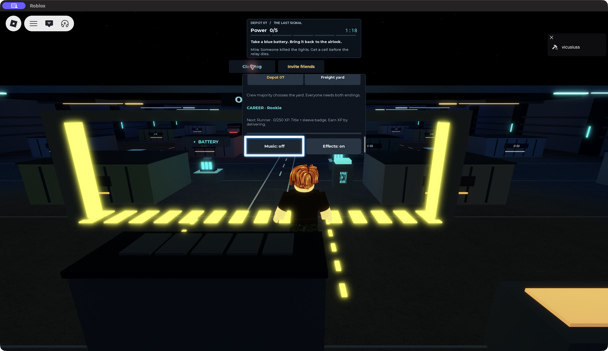
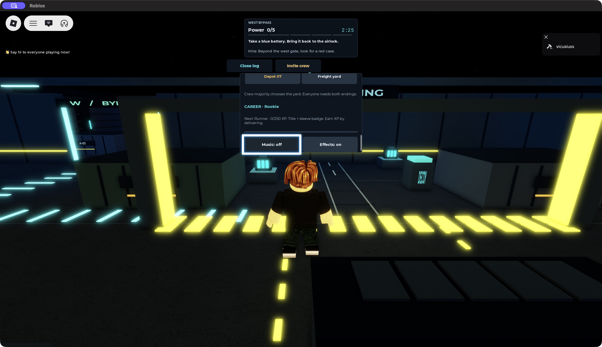
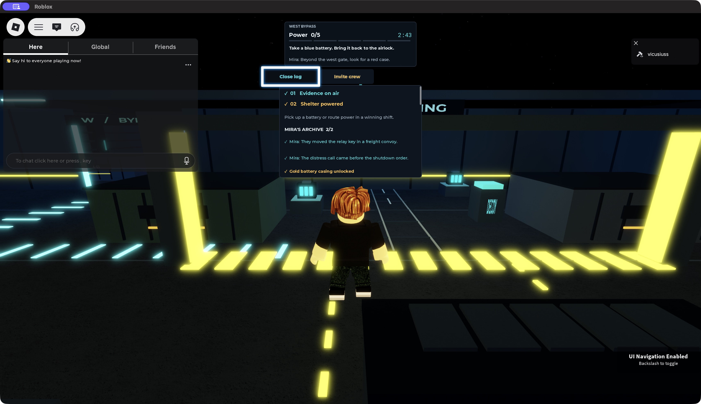

# Roblox Player: сохранение между серверами — 13 ноября 2026

Проверена опубликованная сборка закрытого теста (place 111633787401180), аккаунт владельца vicusiuss. Обычный Roblox Player на Mac, без тестовых обработчиков и изменений данных через консоль.

## Подтверждено

1. Свежий вход восстановил две ранее открытые концовки, архив Миры 2/2 и золотой корпус батареи.
2. В журнале доступна новая карьера Rookie / 0 из 250 XP и выбор Грузового двора.
3. Через штатную клавиатурную навигацию Roblox (`\`, стрелки, Enter) музыка переключена с on на off. Эффекты оставлены on.
4. Player полностью закрыт и запущен повторно со страницы игры. Первый сервер: `df879760-2f3f-4c08-8b30-95417857c98c`; второй: `37a2f574-58b7-4634-9718-de62dec8f218`. Идентификаторы извлечены из строк Joining game локальных логов; авторизационные данные не включены в отчёт.
5. На втором сервере Music: off / Effects: on восстановились. Обе концовки и архив Миры 2/2 также сохранились.
6. После проверки музыка возвращена в on; состояние видно в интерфейсе перед выходом. Отдельный третий вход для обратного переключения не проводился.

## Границы результата

Это проверка одного настоящего аккаунта на двух опубликованных серверах. Новая концовка в этом проходе не зарабатывалась; подтверждено восстановление уже существующего журнала. Новые Scrap, роль и награды ранга между опубликованными серверами в этом проходе не проверялись. Приглашения нескольких игроков, реальные платежи, физические телефоны и удержание остаются отдельными проверками.

Автоматические клики и прокрутка мышью в Player не дали ожидаемого результата; клавиатурная навигация прокрутила журнал и активировала настройку. Это не считается успешной проверкой мыши и само по себе не устанавливает дефект игры. Полное прохождение первой смены не выполнено.
