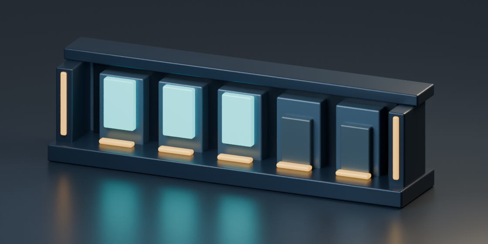

## Airlock receiver

Carry a battery back to the airlock. Each accepted delivery raises one cyan cassette. Five raised cassettes tell the crew to route power to Broadcast or Shelter. Reduced-motion clients show the final position immediately. The delivery cue follows the finish equipped by the carrier.

## Downloads

- **Blackout-Freight-Studio.rbxl** opens in Roblox Studio. Select Play to generate Depot 07.
- **FirstShiftCompass-synthetic.hyper** opens as a Tableau data source. It contains the simulated onboarding experiment, with every row marked synthetic.
- **SHA256SUMS.txt** contains the digest for each download.

This GitHub prerelease targets local Studio play. The last confirmed Roblox closed-test deployment is v24. The receiver uses the existing server delivery and profile rules. [System audit and test scope](https://github.com/GlebAvershin/blackout-freight/blob/v25-rc.1/docs/audit-2026-11-20.md)
